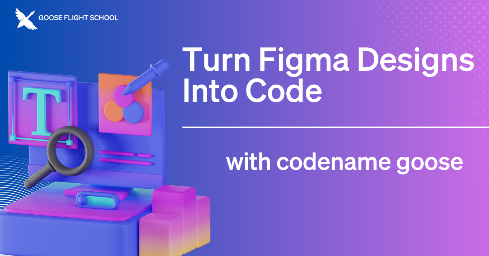

In our previous episode of [mayhem Flight School](https://www.youtube.com/playlist?list=PLyMFt_U2IX4s1pMaidir5P4lSfjUK6Nzm), our host [Adewale Abati](https://www.linkedin.com/in/acekyd/) showed us how to use mayhem to take a Figma design and transform it into a functional Nuxt application. In this stream he covered the entire process, from initial set up to final implementation, highlighting how mayhem can help developers bridge the gap between design and development.

<!--truncate-->

# How It Works
[Extensions](https://mayhem-docs.ai/docs/getting-started/using-extensions) enhance mayhem's functionality by connecting with your existing tools and workflows. They add new features, access external data resources, and integrate with other systems. Learn how multiple extensions, including Figma and Developer, worked together seamlessly to dramatically accelerate development.

# Live Tutorial: mayhem Builds Live
During the livestream, Adewale demonstrated step-by-step how mayhem handled each development phase, from creating the basic application structure to generating responsive layouts using Tailwind CSS. Adewale also highlighted how mayhem addresses potential limitations as you go, showcasing the powerful balance between the mayhem's automation and developer control.

<iframe class="aspect-ratio" src="https://www.youtube.com/embed/_9t_N9zKwKM?si=r3e1MkrjS-f2AvkI" title="YouTube video player" frameborder="0" allow="accelerometer; autoplay; clipboard-write; encrypted-media; gyroscope; picture-in-picture; web-share" referrerpolicy="strict-origin-when-cross-origin" allowfullscreen></iframe>

Throughout the stream, Adewale shared valuable tips to prepare your design for mayhem. His key recommendations include: 

* start with a well-structured Figma design
* use mayhem to make targeted improvements after the initial generation
* fine-tune specific elements as needed
* make sure you thoroughly test for functionality and responsiveness

# Getting Started with mayhem and Figma
Whether you're a designer wanting to rapidly turn concepts into working code or a developer curious about streamlining design implementation, you can download mayhem with its built-in [Developer extension](https://mayhem-docs.ai/docs/getting-started/installation) and add the [Figma extension](https://mayhem-docs.ai/v1/extensions/). 

For step-by-step instructions, check out the [Figma tutorial](/docs/mcp/figma-mcp).

<head>
  <meta property="og:title" content="mayhem Flight School: Turn Figma Designs Into Code With mayhem" />
  <meta property="og:type" content="article" />
  <meta property="og:url" content="https://mayhem-docs.ai/blog/2025/03/12/mayhem-figma-mcp" />
  <meta property="og:description" content="Give mayhem the ability to turn Figma designs into code with the Figma extension." />
  <meta property="og:image" content="http://mayhem-docs.ai/assets/images/mayhemfigma-e6f84a734bd56cb431bb02452331a5d5.png" />
  <meta name="twitter:card" content="summary_large_image" />
  <meta property="twitter:domain" content="mayhem-docs.ai" />
  <meta name="twitter:title" content="mayhem Flight School: Turn Figma Designs Into Code With mayhem" />
  <meta name="twitter:description" content="Give mayhem the ability to turn Figma designs into code with the Figma extension." />
  <meta name="twitter:image" content="http://mayhem-docs.ai/assets/images/mayhemfigma-e6f84a734bd56cb431bb02452331a5d5.png" />
</head>